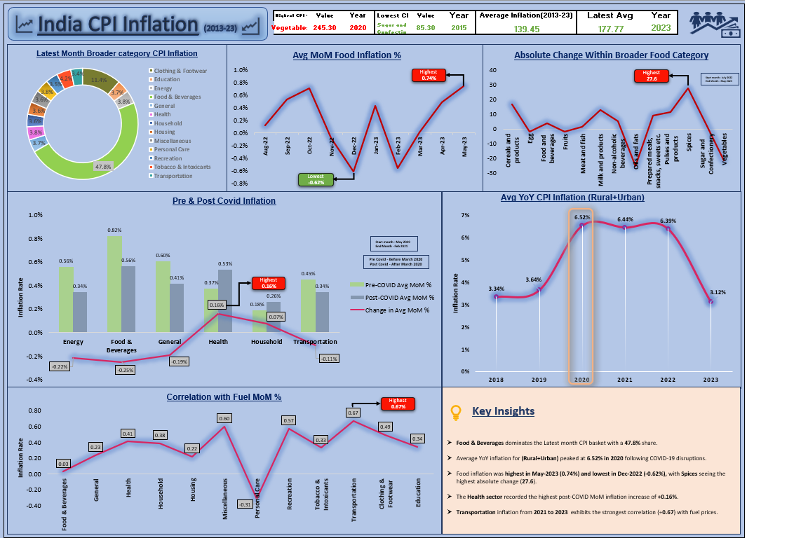

# India Consumer Price Index (CPI) Inflation Dashboard

An interactive Excel dashboard analysing India's Consumer Price Index (CPI) inflation for 2013-2023 on 10,000+ cleaned records, built with pivot tables, charts and formulas.

## Objective

To understand what drives inflation in India by breaking CPI down by category, time period and external factors such as COVID-19 and fuel prices.

## Tools & Skills

- Microsoft Excel
- Pivot Tables and Pivot Charts
- Data Cleaning
- Formulas and KPI Cards
- Data Visualization and Dashboard Design
- Correlation Analysis

## Dashboard KPIs

| KPI | Value |
|---|---|
| Highest CPI category | Vegetables (245.3 in 2020) |
| Lowest CPI category | Sugar and Confectionery (85.3 in 2015) |
| Average CPI, 2013-23 | 139.45 |
| Latest average CPI (2023) | 177.77 |

## Analysis & Key Insights

**Task 1: Broader category contribution to CPI (May 2023)**
Food & Beverages contributes the highest share (47.8%) to CPI in the latest month, far ahead of every other broad category.

**Task 2: YoY CPI trend, Rural + Urban (2017-2023)**
Average YoY inflation peaked in 2020 at 6.52%, driven largely by COVID-19-related disruptions to supply chains and production. It eased to 3.12% in 2023.

**Task 3: Food inflation, 12 months ending May 2023**
- Average MoM food inflation was highest in May 2023 (0.74%) and lowest in Dec 2022 (-0.62%).
- Spices recorded the largest absolute increase (+27.6 points).
- Oils and Fats saw the largest fall (-25.0 points).

**Task 4: Pre- vs post-COVID impact (before vs after March 2020)**
Health saw the highest increase in average MoM inflation after COVID onset (+0.16%), while Energy, Food & Beverages and Transportation slowed.

**Task 5: Fuel price correlation (2021-2023)**
Transportation inflation shows the strongest correlation with fuel prices (+0.67), while Personal Care shows a negative correlation (-0.31).

## Workbook Structure

| Sheet | Purpose |
|---|---|
| Dashboard | Final dashboard with KPIs and charts |
| Task1_Broader_Category | Category contribution to CPI |
| Task2_Inflatio(Rural+Urban) | YoY inflation trend |
| Task3_Broader_Food Cat | Food category and sub-category analysis |
| Task4_Pre-Post_Covid | Pre vs post-COVID comparison |
| Task5_Oil_Correlation | Fuel proxy correlation analysis |
| Cleaned Data | Cleaned dataset used for pivots |
| Bucket | Category-to-broad-category mapping |
| All_India_Index_Upto_April23 | Raw All India CPI index data |

## How to Use

1. Download `CPI.xlsx` from this repository.
2. Open it in Microsoft Excel.
3. Start on the **Dashboard** sheet, then explore the Task sheets to see the pivot tables and charts behind each insight.

